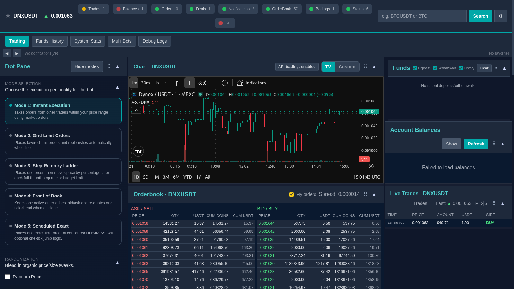

# MEXC Trading Dashboard and Bot Suite

MEXC Trading Dashboard and Bot Suite is a self-hosted trading desk for MEXC spot markets: a browser dashboard with a chart, order book, trades tape, balances and order controls, and a bot engine with five automation modes behind it. One operator with MEXC API keys uses it to trade by hand and to run scripted strategies from the same screen, with order feedback and bot logs next to the market.

## Tech stack

| Layer | Technologies |
|---|---|
| Application | Python with FastAPI and a bot engine |
| Trading interface | HTML, CSS and JavaScript, with a TradingView chart that can be switched on and off |
| Exchange integration | MEXC spot REST API and WebSocket streams with Protocol Buffers messages |

## The trading desk

Panels can be moved, resized and collapsed. Save Layout stores the arrangement, Reset Layout restores the default and Snapshot UI captures the current screen. The header keeps the selected symbol and the connection state in view, and notification settings choose which events are announced. Live streams for orders, deals, deposits, balances, trades and the order book feed the panels.

## Market and manual orders

The market view combines the chart, the order book with depth and the live trades tape, and a symbol search switches all of them to another market. The Trading Panel places buy and sell orders beside the balances, with size shortcuts of 25, 50, 75 and 100 percent of the available funds, fixed dollar amounts and a custom amount, in coins or in USDT. Open orders can be cancelled or modified, and order history, a live stream of deals and the Funds History tab with deposits show what happened after an action.

## Automation modes

The Bot Panel offers five modes. Mode 1, Instant Execution, takes orders inside a price range with immediate-or-cancel limit orders and a TAKE, PING, 50/50 or RANDOM execution style. Mode 2, Grid Limit Orders, places layered limit orders in a range and replenishes them when filled. Mode 3, Step Re-entry Ladder, places an order and moves the price by a percentage after each full fill until a stop rule or the budget is reached. Mode 4, Front of Book, keeps one resting order at the best bid or ask and re-quotes when it is displaced. Mode 5, Scheduled Exact, places one exact limit order at a set time (HH:MM:SS) with an optional one-tick jump.

## Presets, dry run and logs

Bot settings can be saved as presets in the browser and applied again, so a repeated strategy does not need to be entered from memory. A dry-run option lets a setup run its decisions and log what it would have placed without sending orders. Each running bot shows its status and its own log stream, a Multi Bots workspace covers several bot contexts, and a performance view reports bot activity. System statistics and debug logs help when an order event or a delay needs explaining, and the history of orders, deals, funds and bot logs is persisted so a session can be reviewed later.

Exchange use is subject to the MEXC terms.

---

Private code: [mexc-trading-dashboard-bot-suite](https://github.com/logicencoder/mexc-trading-dashboard-bot-suite)

See [REPOS.md](REPOS.md) for related repositories.

**[Logic Encoder](https://logicencoder.com)** · [GitHub](https://github.com/logicencoder) · [Contact](https://logicencoder.com/contact/)
